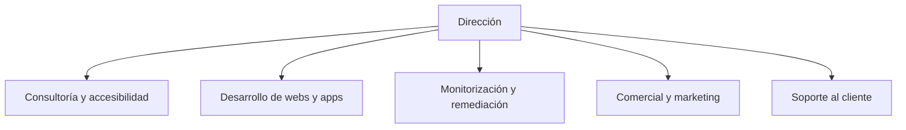
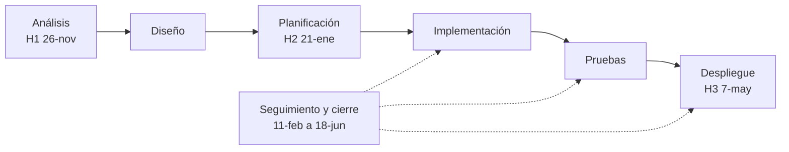

# 01 · Análisis y documentación inicial (RA1)

## 1. Sector y empresas (CE 1a, 1b)

**Sector:** accesibilidad digital: empresas que venden software y servicios para que webs y aplicaciones cumplan las pautas WCAG y la norma europea EN 301 549. Código CNAE: **pendiente de localizar** en el INE.

| Empresa | Tamaño | Forma | Ámbito | Servicio | Fuente y fecha | Estado |
|---|---|---|---|---|---|---|
| inSuit | no lo dice | no lo dice (las auditorías las hace la unidad de inspección de Everycode S.L., acreditada por ENAC) | Clientes públicos y privados (logos de organizaciones españolas) | Plataforma inSuit 360: servicios de consultoría, herramientas (cumplimiento, remediación, PDF, monitorización) y certificación AA válida 2 años | https://insuit.net/ · 2026-11-16 | `leído` |
| Tech4access | no lo dice | no lo dice | Oficinas en Valencia y Londres; clientes de administraciones y empresas | Consultoría y soluciones de accesibilidad y usabilidad: webs y apps accesibles, monitorización, remediación de documentos, chatbots accesibles, subtitulado automático | https://www.tech4access.com/ · 2026-11-16 | `leído` |
| Deque Systems | no lo dice | Deque Systems, Inc. (EE. UU.) con filiales en Países Bajos e India | Internacional (EE. UU., Utrecht, Hyderabad); fundada en 1999 | Plataforma Axe (herramientas de pruebas y monitorización), motor abierto axe-core, auditorías, consultoría y formación | https://www.deque.com/company/ · 2026-11-16 | `leído` |
| Siteimprove | más de 400 empleados | Empresa privada (no cotiza); Nordic Capital es accionista mayoritario desde 2020 | Internacional: oficinas en Bellevue, Copenhague, Londres y Minneapolis; fundada en Dinamarca en 2003 | Plataforma de accesibilidad y gobernanza digital, analítica de experiencia, visibilidad en buscadores y estrategia de contenidos | https://www.siteimprove.com/about-us/ · 2026-11-16 | `leído` |
| Level Access | no lo dice | no lo dice | Internacional: Stafford (EE. UU.), Toronto y Bristol; fundada en 1999 | Plataforma (auditoría y pruebas, corrección, gobernanza), formación, pruebas en CI/CD, móviles y PDF, y servicios gestionados | https://www.levelaccess.com/about/ · 2026-11-16 | `leído` |

**Agrupación** (por ámbito y por tipo de oferta):

- **Consultoras españolas con herramientas propias:** inSuit y Tech4access. Venden servicios y, además, su propia tecnología.
- **Fabricante con motor abierto:** Deque Systems. Plataforma de pago, pero con el motor axe-core publicado como código abierto.
- **Proveedores internacionales de plataforma:** Siteimprove y Level Access. Plataformas de pago con servicios, con varias sedes en distintos países.

**Límite:** no he encontrado una pyme local de Asturias que pudiera abrir; queda **pendiente** ampliar la lista.

**Empresa tipo: Tech4access.** Es el patrón de consultora española que combina servicios y herramientas, y es el más cercano al contexto de AriaScope (webs de pequeñas organizaciones y administraciones). Su web no publica el organigrama: el siguiente es una **deducción mía a partir de su lista de servicios**, no un dato publicado.

**Cómo leerlo:** cada caja es un área y cada flecha va de Dirección al área que depende de ella.

Funciones (deducidas):

- **Dirección:** decide la estrategia, los precios y las alianzas.
- **Consultoría y accesibilidad:** audita webs y apps y asesora sobre el cumplimiento de WCAG y EN 301 549.
- **Desarrollo de webs y apps:** construye sitios y aplicaciones accesibles para los clientes.
- **Monitorización y remediación:** vigila de forma continua las webs de los clientes y corrige fallos, también en documentos.
- **Comercial y marketing:** presenta los servicios, prepara propuestas y publica contenidos.
- **Soporte al cliente:** atiende dudas tras la implantación y coordina con las demás áreas.

## 2. Necesidades y oportunidades (CE 1c, 1d)

**Criterio de prioridad:** número de fuentes leídas que mencionan la necesidad, de más a menos. Entre dos con el mismo número, ordeno primero la más cercana a lo que haría AriaScope (opinión mía). **Aviso:** la mayoría de fuentes son webs comerciales, así que el criterio refleja lo que venden, no necesariamente lo que piden los clientes.

| Prioridad | Necesidad | Fuentes leídas | Por qué en este puesto |
|---|---|---|---|
| 1 | Integrar las pruebas en el trabajo de quien desarrolla (integración continua, editor, código abierto) | 4: Pa11y CI, Lighthouse (módulo de Node), Level Access (Level CI) y Deque (linter para VS Code) | Es lo que AriaScope haría directamente |
| 2 | Vigilar la accesibilidad de forma continua, no solo en una auditoría | 4: inSuit (Monitor), Tech4access (monitorización), Axe Monitor y Siteimprove | Mismo número de fuentes; la cubren sobre todo servicios de pago |
| 3 | Cumplir una norma y poder demostrarlo (certificado, VPAT) | 4: inSuit (certificación AA), Tech4access (insignia EN 301 549), Deque (VPAT) y Level Access (VPAT/ACR) | Requiere personas expertas: queda fuera del alcance de AriaScope |
| 4 | Saber qué obliga y desde cuándo | 2: AccessibleEU (Comisión Europea) y Ley 11/2023 | Contexto que da urgencia, no una función |
| 5 | Corregir los fallos más repetidos (contraste, texto alternativo, etiquetas, enlaces y botones vacíos) | 1, con cifras: WebAIM Million 2026 | Es lo que una herramienta automática sí detecta |
| 6 | **Opinión mía:** una herramienta gratuita y entendible para quien no es especialista | 0 | Lo deduzco de que las soluciones de pago leídas solo piden una demo; no lo respalda ninguna fuente |

**Dato cuantitativo:** según el estudio WebAIM Million 2026 (datos de febrero de 2026), el **95,9 %** de las páginas de inicio analizadas tenía fallos detectables de WCAG 2 (94,8 % en 2025), con una media de **56,1 errores** por página. Los más frecuentes: texto con poco contraste (83,9 % de las páginas), imágenes sin texto alternativo (53,1 %), campos de formulario sin etiqueta (51 %), enlaces vacíos (46,3 %), botones vacíos (30,6 %) y documento sin idioma (13,5 %). Fuente: https://webaim.org/projects/million/ · 2026-11-16 · `leído`. Este estudio solo cuenta fallos que detecta una herramienta automática.

**Oportunidad:**

- Casi todas las webs analizadas tienen fallos que una herramienta automática ya detecta, así que hay trabajo por hacer.
- La Comisión Europea indica que el Acta Europea de Accesibilidad se aplica desde el 28 de junio de 2025 y alcanza, entre otros, a sitios web y aplicaciones móviles de determinados servicios (https://accessible-eu-centre.ec.europa.eu/content-corner/news/eaa-comes-effect-june-2025-are-you-ready-2025-01-31_en · 2026-11-16 · `leído`). España la traspone con la Ley 11/2023, de 8 de mayo (https://www.boe.es/buscar/act.php?id=BOE-A-2023-11022 · 2026-11-16 · `leído` el título y la fecha de publicación).
- **Lo que no sé:** cuántas pymes lo necesitan y si les basta una herramienta gratuita. Queda **pendiente** de contrastar con datos de INE u ONTSI y con personas del sector.

## 3. Tipo de proyecto elegido (CE 1e)

**Tipo de proyecto:** producto de software de código abierto, en forma de herramienta de línea de comandos.

Comparación con los mismos criterios (valoración mía):

| Opción | Coste | Tiempo | Encaje con los módulos de 2.º |
|---|---|---|---|
| Herramienta de línea de comandos de código abierto (Playwright + axe-core) | bajo: sin servidor ni cuentas | medio | alto (0612, 0614 y 0615) |
| Aplicación web con cuentas y panel | medio-alto: servidor, base de datos y cuentas | alto | alto (0613 y 0615), pero compite directamente con las plataformas de pago |
| Extensión de navegador | bajo | medio | medio |

**Elijo la herramienta de línea de comandos.** Descarto la aplicación web porque exige servidor, base de datos y cuentas, y no llegaría con calidad a H3. Descarto la extensión porque ya existe una (Deque ofrece la extensión *axe DevTools* para Chrome, según https://www.deque.com/company/ · 2026-11-16 · `leído`) y no aportaría nada nuevo.

## 4. Requisitos y restricciones (CE 1f)

### Requisitos

Parto de las funcionalidades de [`00-documentoInicio.md`](00-documentoInicio.md) y de lo encontrado en [`01b-sota.md`](01b-sota.md). Los umbrales numéricos son **propuestas mías** que mediré en H2 y H3.

| ID | Requisito | Tipo (funcional / no funcional / restricción) | Cómo se verifica |
|---|---|---|---|
| RF-01 | Dada una dirección `http` o `https`, la herramienta abre la página con Playwright, ejecuta axe-core y muestra los fallos detectados | funcional | Sobre una página de prueba con 3 fallos conocidos, el informe los lista los 3 |
| RF-02 | Genera el informe en Markdown y en JSON | funcional | Se crean los dos ficheros y el JSON se puede leer con un analizador de JSON sin error |
| RF-03 | El informe separa «fallo detectado» (resultados `violations` de axe-core) de «a revisar a mano» (resultados `incomplete`) | funcional | Sobre la misma página de prueba, cada grupo aparece en su sección y ningún resultado está en las dos |
| RF-04 | Analiza una lista de direcciones leída de un fichero (no imprescindible) | funcional | Con un fichero de 3 direcciones se generan 3 informes |
| RF-05 | Devuelve un código de salida distinto de cero si hay fallos detectados (no imprescindible) | funcional | `echo $?` vale 0 en una página sin fallos y distinto de 0 en una con fallos |
| RNF-01 | Usabilidad: cada fallo indica la regla, el elemento afectado y un enlace a su explicación | no funcional | Una persona no especialista explica con sus palabras 3 fallos del informe sin ayuda (pendiente de buscar a esa persona) |
| RNF-02 | Rendimiento: analiza una página en menos de 60 s con conexión doméstica | no funcional | Se cronometran 10 ejecuciones sobre páginas de prueba; el umbral es propuesta mía y **pendiente de medir** |
| RNF-03 | Privacidad: no guarda datos personales ni envía información a terceros; solo se conecta a la dirección analizada | no funcional | Revisión del código y del tráfico de red en una ejecución (pendiente) |
| RNF-04 | Honestidad: el informe avisa de que el análisis automático no cubre toda la accesibilidad | no funcional | El texto del aviso aparece en los informes Markdown y JSON |
| REST-01 | Plazo: primera versión mínima funcional antes de H3 (7-may-2027) | restricción | Existe el tag `h3` con RF-01 a RF-03 funcionando |
| REST-02 | Tecnología: TypeScript y Node.js, Playwright y axe-core, todas de código abierto y sin servicios de pago | restricción | `package.json` lista solo esas dependencias y sus licencias son de código abierto (pendiente de comprobar cada licencia) |
| REST-03 | Uso: solo se analizan páginas propias o de prueba | restricción | El `README.md` lo indica y las pruebas usan solo páginas de prueba propias |

### Objetivos

| ID | Objetivo | Cómo se mide |
|---|---|---|
| OBJ-01 | Que una persona no especialista analice la accesibilidad de una página web desde la terminal con un solo comando | En una página de prueba propia, un solo comando devuelve el informe sin más configuración (prueba de aceptación) |
| OBJ-02 | Que el informe separe lo detectado como fallo de lo que hay que revisar a mano | En una página de prueba con fallos conocidos, el informe muestra los dos grupos en secciones distintas (sí/no) |
| OBJ-03 | Poder usar la herramienta en integración continua | En un flujo de GitHub Actions de prueba, el trabajo falla si hay fallos y pasa si no los hay |
| OBJ-04 | Publicarla como código abierto con documentación suficiente | Una persona ajena al proyecto la instala y la ejecuta siguiendo solo el `README.md` (prueba con 1 persona) |

### Matriz de trazabilidad

En H1 solo se unen objetivo y requisito. El resto se completa en H2 y H3; `ariascope <url>` es un **nombre provisional** de la orden.

| Objetivo | Requisito | Caso de uso | Pantalla o endpoint | Prueba o indicador |
|---|---|---|---|---|
| OBJ-01 | RF-01 | pendiente | orden `ariascope <url>` | pendiente |
| OBJ-01 | RNF-01 | pendiente | informe | pendiente |
| OBJ-01 | RNF-02 | pendiente | orden `ariascope <url>` | pendiente |
| OBJ-02 | RF-03 | pendiente | informe | pendiente |
| OBJ-02 | RNF-04 | pendiente | informe | pendiente |
| OBJ-03 | RF-05 | pendiente | código de salida | pendiente |
| OBJ-03 | RF-04 | pendiente | orden con fichero de direcciones | pendiente |
| OBJ-04 | RF-02 | pendiente | ficheros de informe | pendiente |
| OBJ-04 | RNF-03 | pendiente | código y red | pendiente |

Las restricciones REST-01 a REST-03 no cuelgan de un objetivo concreto: acotan todo el proyecto.

## 5. Obligaciones fiscales, laborales y de prevención (CE 1g)

**A quién ayuda el proyecto (perfil supuesto, opinión mía):** una pyme o un autónomo de Asturias con una web propia y una o dos personas contratadas, que trabajan con pantalla. No he hablado con ninguna, así que el perfil no está contrastado. Texto leído en el BOE el 2026-11-19.

| Obligación | Por qué le toca | Norma (con enlace) | Estado |
|---|---|---|---|
| IVA y facturas | Vende productos o servicios | [Ley 37/1992, del IVA](https://www.boe.es/buscar/act.php?id=BOE-A-1992-28740), arts. 1, 4 y 5 | `leído` (2026-11-19) |
| Impuesto sobre la renta o sobre sociedades | Tributa según sea autónomo o sociedad | [Ley 35/2006, del IRPF](https://www.boe.es/buscar/act.php?id=BOE-A-2006-20764) y [Ley 27/2014, del Impuesto sobre Sociedades](https://www.boe.es/buscar/act.php?id=BOE-A-2014-12328), art. 1 de cada una | `leído` solo el art. 1 de cada una (2026-11-19) |
| Contrato y registro de jornada | Tiene personas contratadas | [Estatuto de los Trabajadores (RDL 2/2015)](https://www.boe.es/buscar/act.php?id=BOE-A-2015-11430), arts. 8 y 34.9 | `leído` (2026-11-19) |
| Prevención de riesgos laborales (PRL) | Su plantilla trabaja con pantalla | [Ley 31/1995](https://www.boe.es/buscar/act.php?id=BOE-A-1995-24292), arts. 14 a 16 | `leído` (2026-11-19) |
| Protección de datos | Su web puede guardar datos de personas (AriaScope no los guarda: RNF-03) | [Ley Orgánica 3/2018](https://www.boe.es/buscar/act.php?id=BOE-A-2018-16673) | `sin leer`: solo he leído el título |
| Accesibilidad de productos y servicios | Si ofrece comercio electrónico a consumidores | [Ley 11/2023](https://www.boe.es/buscar/act.php?id=BOE-A-2023-11022), arts. 2 y 3.3 | `leído` solo el art. 2 (incluye «servicios de comercio electrónico») y el 3.3 (2026-11-19) |

**Qué dicen los artículos leídos** (resumen mío):

- **Ley 37/1992:** el IVA grava las entregas de bienes y prestaciones de servicios que hacen empresarios y profesionales en su actividad.
- **Estatuto de los Trabajadores:** el art. 34.9 obliga a la empresa a garantizar el registro diario de jornada, con el horario de inicio y fin de cada persona.
- **Ley 31/1995:** la empresa debe proteger a su plantilla, evaluar los riesgos y planificar la prevención.
- **Ley 11/2023, art. 3.3:** «las microempresas que presten servicios estarán exentas de cumplir los requisitos de accesibilidad». **Lo deduzco yo:** muchos clientes de AriaScope serían microempresas exentas de esa ley, así que la obligación legal no es su motor principal; no he comprobado qué otras normas les aplican (por ejemplo, para la administración pública).

**Lo que AriaScope hace por sí mismo:** el proyecto es una herramienta gratuita de código abierto y no emite facturas, así que no le afecta la norma de facturación con software (Veri\*Factu). Si algún día cobrara por soporte o servicios, entrarían el IVA y la tributación de quien factura: **no lo he estudiado**.

**Lo que no pude comprobar:**

- **Alta en la Seguridad Social y convenio colectivo:** no los he buscado; el convenio dependería de la actividad de cada cliente (se consulta en el REGCON, Registro de Convenios Colectivos).
- **Otras normas de PRL**, como el real decreto sobre trabajo con pantallas: no leídas.
- **Ley 11/2023:** leí solo parte del texto (artículos 2 y 3.3). No he leído las disposiciones transitorias ni los anexos técnicos.
- **Cuántos clientes** del perfil supuesto existen de verdad.

## 6. Ayudas y subvenciones (CE 1h)

**Ayuda elegida: subvenciones para la mejora de la competitividad, innovación y digitalización del pequeño y mediano comercio (Asturias, 2026).**

| Dato | Contenido |
|---|---|
| Convocatoria | Resolución de 1 de julio de 2026 de la Consejería de Ciencia, Industria y Empleo. Extracto en el [BOPA núm. 133, de 13-VII-2026](https://www.asturias.es/bopa/2026/07/13/2026-05798.pdf) (Cód. 2026-05798). Texto completo en la [BDNS, código 916969](https://www.infosubvenciones.es/bdnstrans/GE/es/convocatoria/916969) |
| Quién puede pedirla | Pymes comerciales con establecimiento en Asturias y domicilio social y fiscal en Asturias; también ciertas cooperativas y SAT de núcleos rurales |
| Qué cubre | **Línea 2: nuevas tecnologías e innovación**: comercio electrónico, sistemas integrados de gestión y «mejora de la imagen digital». El extracto **no dice** si una auditoría de accesibilidad entra en esos conceptos |
| Cuánto | Hasta el **50 %** de la inversión subvencionable (80 % con relevo generacional). Total de la convocatoria: 355.000 € |
| Plazo | Desde el día siguiente al 13-jul-2026 hasta **un mes después**. Calculo que terminó a mediados de agosto de 2026 (fecha exacta no comprobada) |
| Cómo se solicita | Solo por vía telemática, en la sede electrónica del Principado, procedimiento AYUD0351T01 |
| Estado | **Cerrada** (consultada el 2026-11-19). No he comprobado si habrá una convocatoria nueva |

**Para qué sirve a AriaScope:** no la pediría AriaScope (es gratuita y no tiene presupuesto de inversión), sino un cliente comercial que quisiera revisar o mejorar su web. Es un indicio de que hay ayudas a la digitalización del comercio, no de que cubran accesibilidad.

**Descartada tras leerla:** la [convocatoria de ayudas para el impulso empresarial](https://www.asturias.es/bopa/2026/06/01/2026-03264.pdf) (BDNS 900148, BOPA de 1-VI-2026) da el 50 % hasta 10.000 €, pero su extracto dice que **no son subvencionables la compra de material informático ni teléfonos móviles**, y el plazo era de 10 días hábiles desde su publicación: también está cerrada.

**Lo que no pude comprobar:**

- Las **bases reguladoras** de la ayuda elegida (BOPA de 10-jun-2025): solo he leído el extracto.
- Si hay una **nueva convocatoria** en 2027 y con qué fechas.
- Otras vías (SEKUENS, Asturias Emprende): no las he revisado a fondo.

## 7. Guion de trabajo (CE 1i)

Fechas copiadas de `docs/fases-del-proyecto.md` del repositorio del curso el 2026-11-19; son **provisionales** hasta que se apruebe el calendario del centro. No hay tablero de GitHub Projects todavía: **pendiente**.

| Fase | Fechas | Tareas principales | Responsable | Hito |
|---|---|---|---|---|
| 1 Análisis | 6-nov a 26-nov-2026 | Sector, necesidades, requisitos, obligaciones y ayudas | Tever; el tutor revisa el PR | **H1 26-nov** |
| 2 Diseño | 26-nov a 11-dic-2026 | Viabilidad, alcance, arquitectura de la herramienta, formato del informe | Tever; el tutor revisa el 10-dic | sin hito |
| 3 Planificación | 10-dic-2026 a 22-ene-2027 | Cronograma, riesgos y presupuesto | Tever | **H2 21-ene** |
| 4 Implementación | 21-ene a 31-mar-2027 | RF-01 a RF-03 (versión mínima), después RF-04 y RF-05 | Tever | sin hito |
| 5 Pruebas | 1-abr a 23-abr-2027 | Plan de pruebas con páginas de prueba propias y corrección de fallos | Tever | sin hito |
| 6 Despliegue | 26-abr a 7-may-2027 | Publicar el paquete y el flujo de integración continua; guía de uso | Tever | **H3 7-may** |
| 7 Seguimiento y cierre | 11-feb a 18-jun-2027 | Registro semanal, memoria y defensa | Tever; el tutor evalúa | sin hito |

**Cómo leerlo:** las seis primeras fases van de izquierda a derecha y los hitos marcan las entregas. La fase 7 corre en paralelo desde febrero hasta junio (líneas de puntos).

## 8. Glosario

Los sinónimos de la tercera columna son **decisiones mías** para que todos los documentos usen una sola palabra.

| Término | Definición | Sinónimos que NO uso |
|---|---|---|
| WCAG | Pautas de accesibilidad de contenido web del W3C (Web Content Accessibility Guidelines) | «normas de accesibilidad» sin más |
| EN 301 549 | Norma europea de requisitos de accesibilidad de productos y servicios de tecnologías de la información | «norma ISO» |
| axe-core | Motor de reglas de accesibilidad de código abierto (de Deque) que AriaScope usa para analizar las páginas | «el validador» |
| Playwright | Biblioteca que controla un navegador de forma automática para abrir las páginas | «el scraper» |
| Fallo detectado | Problema que el motor de reglas confirma sin ayuda de una persona (en axe-core, `violations`) | «error», «bug», «warning» |
| A revisar a mano | Resultado que el motor no puede decidir y que una persona debe comprobar (en axe-core, `incomplete`) | «aviso», «posible fallo» |
| Integración continua | Proceso automático que ejecuta comprobaciones cada vez que se sube código al repositorio | «CI/CD» sin explicar |

---

## Criterios de evaluación de este documento (RA1, texto literal)

- **1a)** Se han clasificado las empresas del sector por sus características organizativas y el tipo de producto o servicio que ofrecen.
- **1b)** Se han caracterizado las empresas tipo indicando la estructura organizativa y las funciones de cada departamento.
- **1c)** Se han identificado las necesidades más demandadas a las empresas.
- **1d)** Se han valorado las oportunidades de negocio previsibles en el sector.
- **1e)** Se ha identificado el tipo de proyecto requerido para dar respuesta a las demandas previstas.
- **1f)** Se han determinado las características específicas requeridas al proyecto.
- **1g)** Se han determinado las obligaciones fiscales, laborales y de prevención de riesgos y sus condiciones de aplicación.
- **1h)** Se han identificado posibles ayudas o subvenciones para la incorporación de nuevas tecnologías de producción o de servicio que se proponen.
- **1i)** Se ha elaborado el guión de trabajo que se va a seguir para la elaboración del proyecto.
