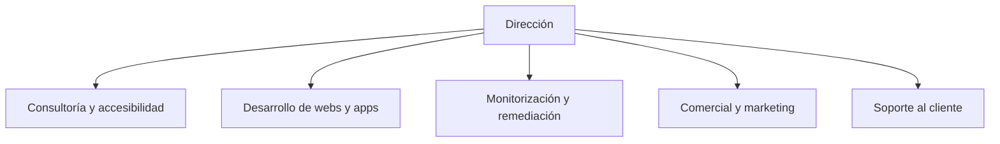

# 01 · Análisis y documentación inicial (RA1)

## 1. Sector y empresas (CE 1a, 1b)

**Sector:** accesibilidad digital: empresas que venden software y servicios para que webs y aplicaciones cumplan las pautas WCAG y la norma europea EN 301 549. Código CNAE: **pendiente de localizar** en el INE.

| Empresa | Tamaño | Forma | Ámbito | Servicio | Fuente y fecha | Estado |
|---|---|---|---|---|---|---|
| inSuit | no lo dice | no lo dice (las auditorías las hace la unidad de inspección de Everycode S.L., acreditada por ENAC) | Clientes públicos y privados (logos de organizaciones españolas) | Plataforma inSuit 360: servicios de consultoría, herramientas (cumplimiento, remediación, PDF, monitorización) y certificación AA válida 2 años | https://insuit.net/ · 2026-11-16 | `leído` |
| Tech4access | no lo dice | no lo dice | Oficinas en Valencia y Londres; clientes de administraciones y empresas | Consultoría y soluciones de accesibilidad y usabilidad: webs y apps accesibles, monitorización, remediación de documentos, chatbots accesibles, subtitulado automático | https://www.tech4access.com/ · 2026-11-16 | `leído` |
| Deque Systems | no lo dice | Deque Systems, Inc. (EE. UU.) con filiales en Países Bajos e India | Internacional (EE. UU., Utrecht, Hyderabad); fundada en 1999 | Plataforma Axe (herramientas de pruebas y monitorización), motor abierto axe-core, auditorías, consultoría y formación | https://www.deque.com/company/ · 2026-11-16 | `leído` |
| Siteimprove | más de 400 empleados | Empresa privada (no cotiza); Nordic Capital es accionista mayoritario desde 2020 | Internacional: oficinas en Bellevue, Copenhague, Londres y Minneapolis; fundada en Dinamarca en 2003 | Plataforma de accesibilidad y gobernanza digital, analítica de experiencia, visibilidad en buscadores y estrategia de contenidos | https://www.siteimprove.com/about-us/ · 2026-11-16 | `leído` |
| Level Access | no lo dice | no lo dice | Internacional: Stafford (EE. UU.), Toronto y Bristol; fundada en 1999 | Plataforma (auditoría y pruebas, corrección, gobernanza), formación, pruebas en CI/CD, móviles y PDF, y servicios gestionados | https://www.levelaccess.com/about/ · 2026-11-16 | `leído` |

**Agrupación** (por ámbito y por tipo de oferta):

- **Consultoras españolas con herramientas propias:** inSuit y Tech4access. Venden servicios y, además, su propia tecnología.
- **Fabricante con motor abierto:** Deque Systems. Plataforma de pago, pero con el motor axe-core publicado como código abierto.
- **Proveedores internacionales de plataforma:** Siteimprove y Level Access. Plataformas de pago con servicios, con varias sedes en distintos países.

**Límite:** no he encontrado una pyme local de Asturias que pudiera abrir; queda **pendiente** ampliar la lista.

**Empresa tipo: Tech4access.** Es el patrón de consultora española que combina servicios y herramientas, y es el más cercano al contexto de AriaScope (webs de pequeñas organizaciones y administraciones). Su web no publica el organigrama: el siguiente es una **deducción mía a partir de su lista de servicios**, no un dato publicado.

**Cómo leerlo:** cada caja es un área y cada flecha va de Dirección al área que depende de ella.

Funciones (deducidas):

- **Dirección:** decide la estrategia, los precios y las alianzas.
- **Consultoría y accesibilidad:** audita webs y apps y asesora sobre el cumplimiento de WCAG y EN 301 549.
- **Desarrollo de webs y apps:** construye sitios y aplicaciones accesibles para los clientes.
- **Monitorización y remediación:** vigila de forma continua las webs de los clientes y corrige fallos, también en documentos.
- **Comercial y marketing:** presenta los servicios, prepara propuestas y publica contenidos.
- **Soporte al cliente:** atiende dudas tras la implantación y coordina con las demás áreas.

## 2. Necesidades y oportunidades (CE 1c, 1d)

**Criterio de prioridad:** número de fuentes leídas que mencionan la necesidad, de más a menos. Entre dos con el mismo número, ordeno primero la más cercana a lo que haría AriaScope (opinión mía). **Aviso:** la mayoría de fuentes son webs comerciales, así que el criterio refleja lo que venden, no necesariamente lo que piden los clientes.

| Prioridad | Necesidad | Fuentes leídas | Por qué en este puesto |
|---|---|---|---|
| 1 | Integrar las pruebas en el trabajo de quien desarrolla (integración continua, editor, código abierto) | 4: Pa11y CI, Lighthouse (módulo de Node), Level Access (Level CI) y Deque (linter para VS Code) | Es lo que AriaScope haría directamente |
| 2 | Vigilar la accesibilidad de forma continua, no solo en una auditoría | 4: inSuit (Monitor), Tech4access (monitorización), Axe Monitor y Siteimprove | Mismo número de fuentes; la cubren sobre todo servicios de pago |
| 3 | Cumplir una norma y poder demostrarlo (certificado, VPAT) | 4: inSuit (certificación AA), Tech4access (insignia EN 301 549), Deque (VPAT) y Level Access (VPAT/ACR) | Requiere personas expertas: queda fuera del alcance de AriaScope |
| 4 | Saber qué obliga y desde cuándo | 2: AccessibleEU (Comisión Europea) y Ley 11/2023 | Contexto que da urgencia, no una función |
| 5 | Corregir los fallos más repetidos (contraste, texto alternativo, etiquetas, enlaces y botones vacíos) | 1, con cifras: WebAIM Million 2026 | Es lo que una herramienta automática sí detecta |
| 6 | **Opinión mía:** una herramienta gratuita y entendible para quien no es especialista | 0 | Lo deduzco de que las soluciones de pago leídas solo piden una demo; no lo respalda ninguna fuente |

**Dato cuantitativo:** según el estudio WebAIM Million 2026 (datos de febrero de 2026), el **95,9 %** de las páginas de inicio analizadas tenía fallos detectables de WCAG 2 (94,8 % en 2025), con una media de **56,1 errores** por página. Los más frecuentes: texto con poco contraste (83,9 % de las páginas), imágenes sin texto alternativo (53,1 %), campos de formulario sin etiqueta (51 %), enlaces vacíos (46,3 %), botones vacíos (30,6 %) y documento sin idioma (13,5 %). Fuente: https://webaim.org/projects/million/ · 2026-11-16 · `leído`. Este estudio solo cuenta fallos que detecta una herramienta automática.

**Oportunidad:**

- Casi todas las webs analizadas tienen fallos que una herramienta automática ya detecta, así que hay trabajo por hacer.
- La Comisión Europea indica que el Acta Europea de Accesibilidad se aplica desde el 28 de junio de 2025 y alcanza, entre otros, a sitios web y aplicaciones móviles de determinados servicios (https://accessible-eu-centre.ec.europa.eu/content-corner/news/eaa-comes-effect-june-2025-are-you-ready-2025-01-31_en · 2026-11-16 · `leído`). España la traspone con la Ley 11/2023, de 8 de mayo (https://www.boe.es/buscar/act.php?id=BOE-A-2023-11022 · 2026-11-16 · `leído` el título y la fecha de publicación).
- **Lo que no sé:** cuántas pymes lo necesitan y si les basta una herramienta gratuita. Queda **pendiente** de contrastar con datos de INE u ONTSI y con personas del sector.

## 3. Tipo de proyecto elegido (CE 1e)

**Tipo de proyecto:** producto de software de código abierto, en forma de herramienta de línea de comandos.

Comparación con los mismos criterios (valoración mía):

| Opción | Coste | Tiempo | Encaje con los módulos de 2.º |
|---|---|---|---|
| Herramienta de línea de comandos de código abierto (Playwright + axe-core) | bajo: sin servidor ni cuentas | medio | alto (0612, 0614 y 0615) |
| Aplicación web con cuentas y panel | medio-alto: servidor, base de datos y cuentas | alto | alto (0613 y 0615), pero compite directamente con las plataformas de pago |
| Extensión de navegador | bajo | medio | medio |

**Elijo la herramienta de línea de comandos.** Descarto la aplicación web porque exige servidor, base de datos y cuentas, y no llegaría con calidad a H3. Descarto la extensión porque ya existe una (Deque ofrece la extensión *axe DevTools* para Chrome, según https://www.deque.com/company/ · 2026-11-16 · `leído`) y no aportaría nada nuevo.

## 4. Requisitos y restricciones (CE 1f)

*Características que debe cumplir el proyecto, redactadas de forma **verificable** (no «debe ser rápido», sino «responde en menos de 2 s»). Parte de lo que has encontrado en [`01b-sota.md`](01b-sota.md).*

> **Guía.** Numera los requisitos **funcionales** como **RF-01, RF-02…** (qué hace el sistema) y los **no funcionales** como **RNF-01…** (cómo lo hace: rendimiento, seguridad, usabilidad, disponibilidad, accesibilidad). Las **restricciones** (plazo, presupuesto, tecnología obligatoria, normativa) como **REST-01…**. Cada requisito debe tener **una medida o una prueba**. Si aún no sabes cómo lo probarás, escribe «pendiente» y complétalo antes de H3.

| ID | Requisito | Tipo (funcional / no funcional / restricción) | Cómo se verifica |
|---|---|---|---|
| RF-01 | [RELLENAR] | funcional | |
| RNF-01 | [RELLENAR] | no funcional | |
| REST-01 | [RELLENAR] | restricción | |

### Matriz de trazabilidad

*Une cada objetivo con sus requisitos, y estos con lo que los implementa y los comprueba. Se rellena por completo al final del proyecto; en H1 basta con **objetivo y requisito**.*

> **Guía.** Ejemplo ficticio: *OBJ-01 Gestionar citas → RF-02 Crear una cita → CU-03 → `POST /citas` → prueba P-07.* Cada RF y cada RNF de la tabla anterior debe aparecer aquí.

| Objetivo | Requisito | Caso de uso | Pantalla o endpoint | Prueba o indicador |
|---|---|---|---|---|
| OBJ-01 [RELLENAR] | RF-01 | | | pendiente |

## 5. Obligaciones fiscales, laborales y de prevención (CE 1g)

*Las obligaciones que aplican a tu proyecto, **con su norma** y sus condiciones.*

## 6. Ayudas y subvenciones (CE 1h)

*Al menos **una** ayuda real: fuente, requisitos y plazo.*

## 7. Guion de trabajo (CE 1i)

*Fases, hitos y responsables del proyecto. Puede enlazar al tablero de GitHub Projects.*

## 8. Glosario

*Una cosa, un nombre: define los términos del dominio y de tu proyecto, y anota los sinónimos que **no** vas a usar en ningún documento. Con **5 términos** basta; crece con el proyecto.*

| Término | Definición | Sinónimos que NO uso |
|---|---|---|
| [RELLENAR] | | |

---

## Criterios de evaluación de este documento (RA1, texto literal)

- **1a)** Se han clasificado las empresas del sector por sus características organizativas y el tipo de producto o servicio que ofrecen.
- **1b)** Se han caracterizado las empresas tipo indicando la estructura organizativa y las funciones de cada departamento.
- **1c)** Se han identificado las necesidades más demandadas a las empresas.
- **1d)** Se han valorado las oportunidades de negocio previsibles en el sector.
- **1e)** Se ha identificado el tipo de proyecto requerido para dar respuesta a las demandas previstas.
- **1f)** Se han determinado las características específicas requeridas al proyecto.
- **1g)** Se han determinado las obligaciones fiscales, laborales y de prevención de riesgos y sus condiciones de aplicación.
- **1h)** Se han identificado posibles ayudas o subvenciones para la incorporación de nuevas tecnologías de producción o de servicio que se proponen.
- **1i)** Se ha elaborado el guión de trabajo que se va a seguir para la elaboración del proyecto.
